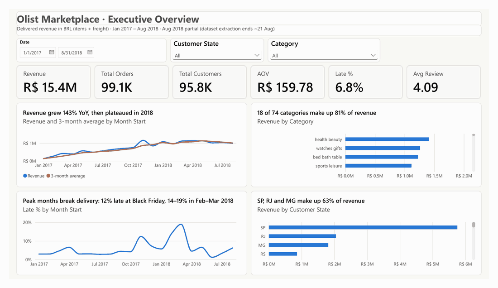
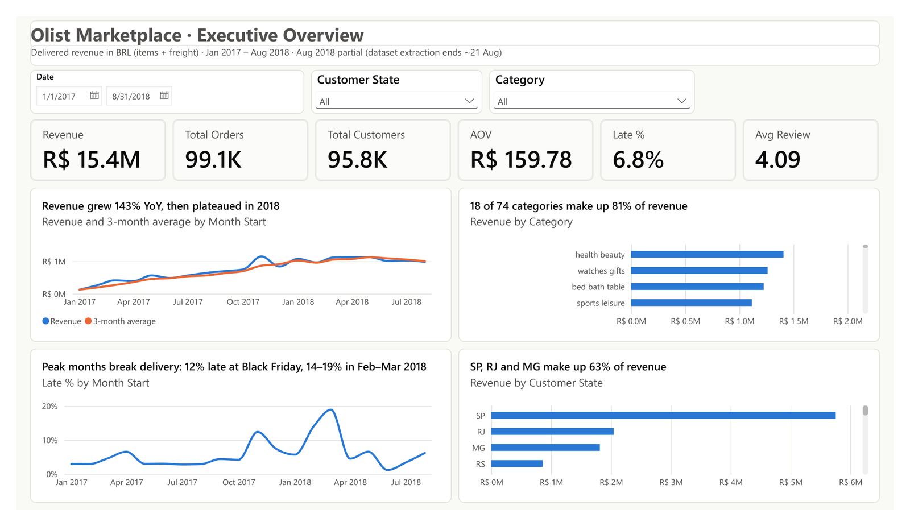
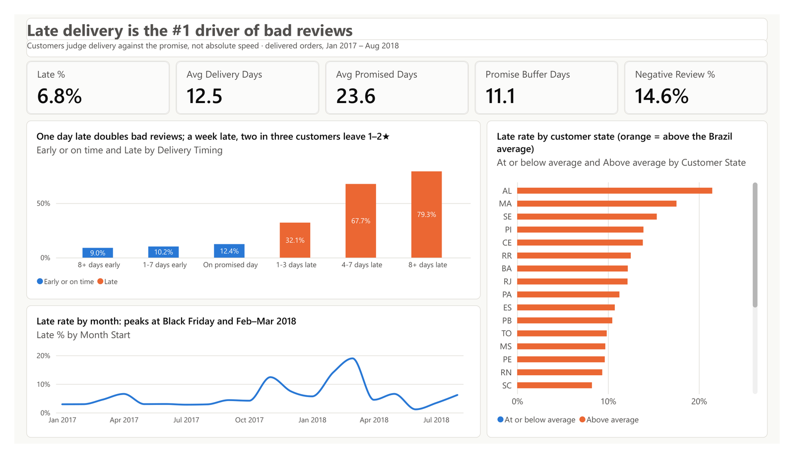
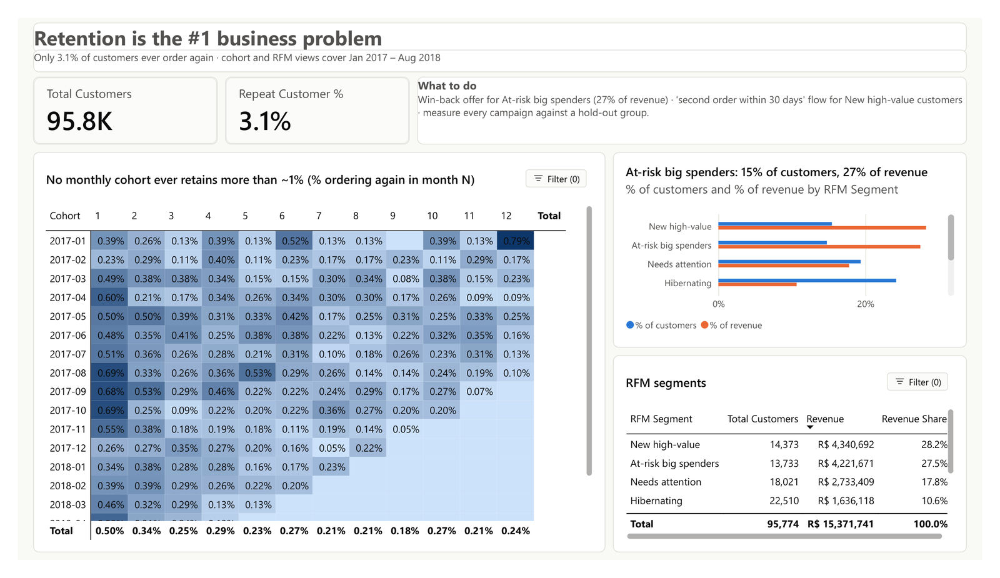
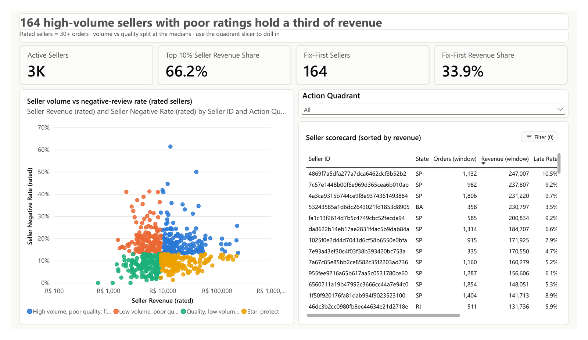

# E-commerce Sales & Customer Insights (Olist, Brazil)

[](https://github.com/Md-Faiz-Alam/ecommerce-sales-customer-insights/actions/workflows/ci.yml)

[](LICENSE)

End-to-end analysis of **~100K real orders** from Olist, a Brazilian marketplace (Jan 2017 – Aug 2018):
SQL star schema, statistical analysis, a Power BI dashboard, and three ML models that turn findings into decisions.

**Stack:** SQL (DuckDB) · Python (pandas, SciPy, scikit-learn, LightGBM) · Power BI (DAX) · Streamlit

> **Main finding:** orders that arrive late average **2.3★** vs **4.3★** on time, and only **3.1%** of
> customers ever buy again. Delivery reliability is the biggest lever for satisfaction and retention.

<p align="center"></p>

## Key findings

1. **One day late doubles bad reviews.** Late orders are 6.7× as likely to get 1–2★ (62% vs 9%). The effect holds in
   every state, so geography doesn't explain it. Lateness causes ~28% of all negative reviews.
2. **Retention is near zero.** Only 3.1% of customers reorder; no monthly cohort retains more than 1%.
3. **Peak season breaks logistics.** Late deliveries jump from 3–6% to 12% at Black Friday and 14–19% in Feb–Mar 2018.
4. **Early delivery earns no credit.** Olist promises ~24 days for a ~12.5-day delivery, but cutting every promise
   by 3 days would raise late deliveries from 6.8% to 11.3%. The fix is per-route promises.
5. **Revenue depends on risky sellers.** 164 high-volume sellers with poor ratings generate 34% of revenue (R$5.2M).

## Power BI dashboard

<p align="center"></p>

<p align="center">
  
  
  
  
</p>

- 5 pages on a star schema with a marked date table; 36 DAX measures (time intelligence, `TOPN` ranking, rolling averages)
- Every KPI reconciles with the SQL warehouse: Revenue R$ 15,371,741 · 99,092 orders · 6.8% late
- Open [`dashboard/Olist_Insights.pbix`](dashboard/Olist_Insights.pbix) (data included) · all DAX in [`measures.dax`](dashboard/measures.dax)

## Recommendations

1. **Set delivery promises per route** with the delivery-time model: on unseen months it cuts late deliveries
   from 3.6% to 1.7% while promising 1.1 days sooner.
2. **Flag risky orders at carrier handoff** and contact them before the rating drops: the riskiest 10% of orders
   account for 28% of future negative reviews. Validate with an A/B test.
3. **Seller SLAs** for the 164 high-volume, low-rated sellers.
4. **Win-back campaign** for "at-risk big spenders" (15% of customers, 27% of revenue).

## What's inside

| Part | What it shows | Where |
|---|---|---|
| **SQL** | Star schema, 8 analysis views (cohorts, RFM, Pareto, seller scorecard) with window functions, 8 SQL data tests | [`sql/`](sql) |
| **Analysis** | 5 notebooks: data quality, business overview, retention, delivery vs reviews (statistical tests), sellers & geography | [`notebooks/01–05`](notebooks) |
| **ML** | Delivery-time model (LightGBM quantiles), review-risk model (SHAP), 28-day demand forecast; time-based splits, no data leakage | [`notebooks/06–08`](notebooks), [`model_report`](reports/model_report.md) |
| **Data quality** | Every cleaning rule with rows affected; data contracts that fail the pipeline on bad data | [`data_quality_report`](reports/data_quality_report.md) |
| **App** | Streamlit: analytics pages, delivery-promise simulator, review-risk checker, forecast | [`app/`](app) |
| **Metrics** | One definition per KPI (revenue, late, repeat customer…) | [`metrics.md`](reports/metrics.md) |
| **Tests** | 47 tests (end-to-end pipeline, leakage, app) run on every push | [`tests/`](tests) |

## Run it

```powershell
.\tasks.ps1 setup      # create .venv and install dependencies (Python 3.13)
.\tasks.ps1 data       # download the Olist CSVs from Kaggle
.\tasks.ps1 pipeline   # clean, validate and build the DuckDB warehouse (~10 s)
.\tasks.ps1 train      # train and evaluate the ML models
.\tasks.ps1 app        # run the Streamlit app
.\tasks.ps1 test       # run all tests
```

## Project structure

```
├── sql/          # star-schema marts, analysis views, SQL data tests
├── notebooks/    # 01–05 analysis, 06–08 machine learning
├── dashboard/    # Power BI dashboard + DAX measures
├── app/          # Streamlit app
├── src/ecom/     # Python package: download, clean, validate, warehouse, features, models
├── tests/        # automated tests
└── reports/      # metric definitions, data-quality and model reports, figures
```

## Limitations

- Orders after 21 Aug 2018 are truncated in the source data, so August 2018 is slightly understated.
- Review scores also depend on product quality, which the data doesn't capture.
- The analysis supports lateness as a cause of bad reviews (dose-response, state-adjusted), but interventions
  should still be validated with A/B tests.

## Data

[Olist Brazilian E-Commerce Public Dataset](https://www.kaggle.com/datasets/olistbr/brazilian-ecommerce) (CC BY-NC-SA 4.0). Values in Brazilian reais (BRL).
