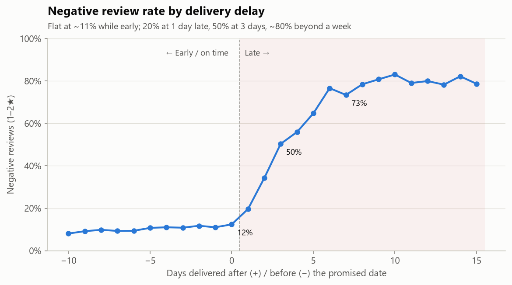
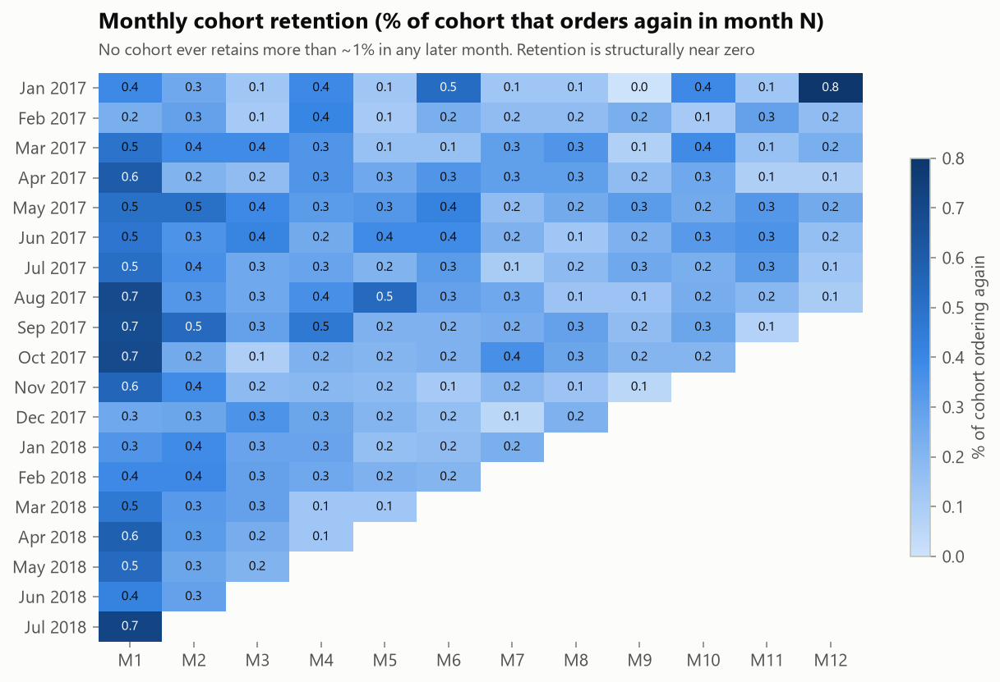

# E-commerce Sales & Customer Insights (Olist, Brazil)

End-to-end analytics on **~100K real orders** from Olist, a Brazilian marketplace (2017–2018):
a reproducible Python + SQL pipeline, a DuckDB warehouse, statistically tested analysis notebooks,
and a Power BI dashboard. Machine-learning models are next.

> **Core finding:** orders that arrive after the promised date average **2.27★**, versus
> **4.29★** for on-time orders, and only **3.1%** of customers ever buy a second time.
> Delivery reliability is the biggest lever for satisfaction and retention.

<p align="center"></p>

## Key findings (R$15.4M revenue, 99K orders, Jan 2017 – Aug 2018)

| # | Finding | Evidence |
|---|---|---|
| 1 | **Even a short delay destroys ratings.** Late orders are **6.7× as likely** to get 1–2★ (62% vs 9%; Mann-Whitney p < 0.001, rank-biserial r = 0.64). The effect holds in every state (state-adjusted relative risk 6.5), so geography doesn't explain it. Lateness causes **~28% of all negative reviews** | [Notebook 04](notebooks/04_delivery_vs_satisfaction.ipynb) |
| 2 | **Retention is close to zero.** Only 3.1% of customers reorder; no monthly cohort ever retains more than 0.8%. 30% of "repeat" orders are same-day split baskets, not loyalty. A late first order cuts the repeat rate by a further 26% (p = 0.002) | [Notebook 03](notebooks/03_customer_retention.ipynb) |
| 3 | **Peak season breaks logistics.** Black Friday (Nov 2017) lifted orders 63% month over month, and the late rate jumped from 4% to **12%**. Feb–Mar 2018 hit **14–19%** late, with ratings falling to 3.75★ | [Notebook 02](notebooks/02_business_overview.ipynb) |
| 4 | **Promises are padded, but a blanket cut backfires.** Olist promises ~24 days for a ~12.5-day delivery, yet early delivery earns no extra rating. Cutting every promise by 3 days would raise the late rate from 6.8% to 11.3%. The fix is **route-level** promises: same-state orders take 7.9 days, cross-state 15.2 | [Notebook 04](notebooks/04_delivery_vs_satisfaction.ipynb) |
| 5 | **Revenue is concentrated, and at risk.** The top 10% of sellers make 66% of revenue. 164 high-volume sellers with above-median negative reviews (19%; nearly double the late rate of top sellers) generate **R$5.2M (34%)** | [Notebook 05](notebooks/05_sellers_and_geography.ipynb) |
| 6 | **The North-East is underserved.** 60% of sellers are in São Paulo; each extra 1,000 km adds ~6 delivery days. AL, MA, SE, CE: 14–21% late, 16–21% of order value spent on freight | [Notebook 05](notebooks/05_sellers_and_geography.ipynb) |
| 7 | **Value sits in lapsing customers.** "At-risk big spenders" (13.7K customers, last seen ~13 months ago) hold 27% of revenue, which makes them the first win-back target | [Notebook 03](notebooks/03_customer_retention.ipynb) |

All metric definitions: [`docs/metrics.md`](docs/metrics.md).

### Recommendations

1. **Predict delivery time per route** and set promises from it: short where safe, long where risky (model in progress).
2. **Day-0 delay alert:** notify customers and offer a small voucher *before* the day-1–3 rating cliff. Measure with an A/B test.
3. **Peak-season playbook** for November and Feb–Mar: carrier capacity, and longer promises on risky routes.
4. **Seller SLAs** for the 164 high-volume, low-quality sellers (34% of revenue).
5. **Win-back campaign** for at-risk big spenders, plus a "second order within 30 days" onboarding flow (the median gap to a second order is 28 days).
6. **North-East seller recruitment / fulfilment hub** to cut distance, freight and lateness together.

---

## Analysis notebooks

Each follows **Question → Method → Finding → Recommendation**, with statistical tests where a claim needs one.

| Notebook | Question | Methods |
|---|---|---|
| [01 Data quality](notebooks/01_data_quality.ipynb) | Can the raw data be trusted? | Missingness patterns, audit trail, contract validation |
| [02 Business overview](notebooks/02_business_overview.ipynb) | Growth, seasonality, revenue mix | MoM/YoY, moving averages, Pareto |
| [03 Customer retention](notebooks/03_customer_retention.ipynb) | Do customers come back? Who should we target? | Cohort analysis, chi-square, RFM segmentation |
| [04 Delivery → satisfaction](notebooks/04_delivery_vs_satisfaction.ipynb) | How much does lateness hurt, and what should we do? | Dose-response, Mann-Whitney U, relative risk + 95% CI, Mantel-Haenszel adjustment, what-if simulation |
| [05 Sellers & geography](notebooks/05_sellers_and_geography.ipynb) | Which sellers and regions need action? | Concentration curve, volume × quality quadrant, distance analysis |

<p align="center">
  
  
  
  
</p>

---

## Quickstart (Windows / PowerShell, Python 3.13)

```powershell
.\tasks.ps1 setup      # create .venv, install pinned dependencies
.\tasks.ps1 data       # download raw Olist CSVs from Kaggle into data/raw/
.\tasks.ps1 pipeline   # clean -> validate -> Parquet -> DuckDB warehouse -> quality report
.\tasks.ps1 notebooks  # re-run the analysis notebooks (refreshes reports/figures)
.\tasks.ps1 test       # unit tests
```

The pipeline rebuilds everything from raw data in about 10 seconds:

- `data/processed/*.parquet`: cleaned tables
- `data/warehouse.duckdb`: queryable warehouse (`staging` schema)
- [`reports/data_quality_report.md`](reports/data_quality_report.md): every cleaning rule and the number of rows it affected, plus all validation results

---

## Pipeline

```
data/raw/*.csv ─► clean.py ─► validate.py ─► DuckDB staging ─► marts (star schema) ─► analysis views
   (Kaggle)       documented   pandera +        Parquet          sql/01_marts          sql/02_analysis
                  rules, flags foreign keys                          └──── sql/tests: 8 data tests ────┘
```

The SQL layer is documented in [`sql/README.md`](sql/README.md): a star schema plus 8 analysis views
using window functions (`LAG`, `NTILE`, `DENSE_RANK`, running totals), cohort indexing, and RFM/ABC
classification. The pipeline fails if any SQL data test (row counts, revenue reconciliation,
uniqueness) breaks.

### Data-cleaning decisions

| Problem found | Decision |
|---|---|
| `customer_id` is generated per order | Customer counts and retention use `customer_unique_id` (**96,096** people, not 99,441) |
| 4 products with weight/dimension = 0, 2 missing | Treated as missing (NA) and flagged; never filled with fake zeros |
| 610 products without a category; names in Portuguese | `unknown`; translated to English, including 2 categories missing from Olist's own translation file |
| 551 orders with several reviews | Keep the latest review per order (order-level grain) |
| Sparse months (Sep–Dec 2016, Sep–Oct 2018) | Kept but flagged `in_analysis_window = false`, and excluded from trends and forecasts |
| 1,359 orders handed to the carrier before payment approval; 8 "delivered" orders with no date | Flagged in `has_timestamp_anomaly`, not silently fixed |
| "Late" definition | Delivered on a calendar day after the promised date (**6.8%** of delivered orders) |
| 1M geolocation points, some outside Brazil | Out-of-country GPS noise removed; collapsed to one median centroid per zip prefix |
| Revenue definition | Completed revenue counts only orders with `is_delivered = true` (delivered status plus a delivery date) |

The full audit trail is in [`reports/data_quality_report.md`](reports/data_quality_report.md).

---

## Dashboard (Power BI)

<p align="center"></p>

> A Power BI revision is planned: proper date table, MoM measures, BRL currency, and English categories.

---

## Project structure

```
├── src/ecom/            # package: pipeline (clean, validate, warehouse), db access, chart style
├── notebooks/           # 01–05 analysis notebooks
├── scripts/             # download_data.py
├── sql/                 # DuckDB: 01_marts (star schema), 02_analysis (views), tests
├── docs/                # metric definitions
├── tests/               # pytest: cleaning rules, data contracts, SQL test runner
├── reports/             # generated data-quality report, figures/
├── dashboard/           # Power BI .pbix
├── images/              # dashboard screenshots
├── data/                # raw + processed (git-ignored; rebuilt by the pipeline)
├── tasks.ps1            # task runner
└── pyproject.toml       # package + tooling config
```

## Roadmap

- [x] Reproducible pipeline, data contracts, data-quality report, tests
- [x] SQL marts (star schema) + cohort retention, RFM, Pareto, seller scorecard, SQL data tests
- [x] Analysis notebooks: delivery → satisfaction (with statistical tests), retention, seller and geography
- [ ] ML: negative-review risk model (LightGBM + SHAP), customer segmentation, demand forecast
- [ ] Live Streamlit app
- [ ] Power BI fixes + executive summary

## Tech stack

Python 3.13 · pandas 3 · DuckDB (SQL) · SciPy · matplotlib · pandera · pytest · ruff · Power BI

## Data

[Olist Brazilian E-Commerce Public Dataset](https://www.kaggle.com/datasets/olistbr/brazilian-ecommerce) (CC BY-NC-SA 4.0). Values are in Brazilian reais (BRL).
