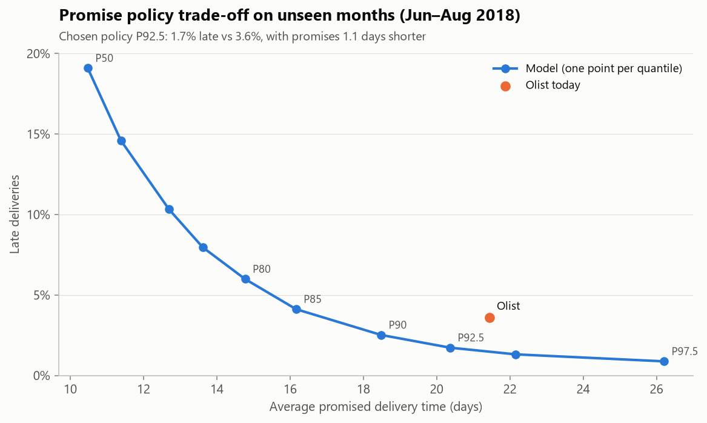
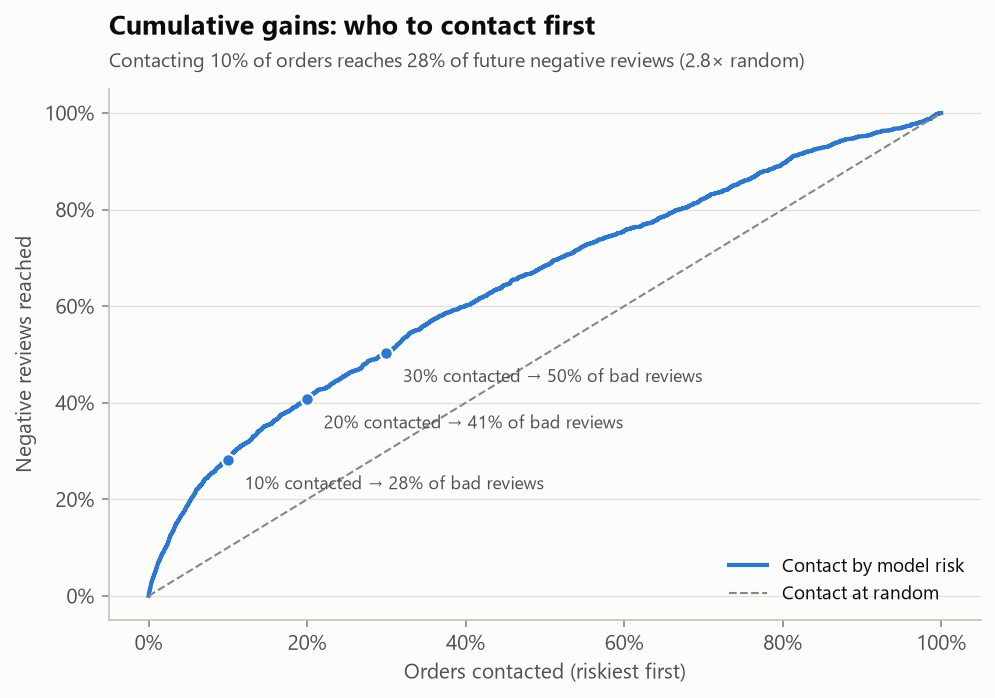
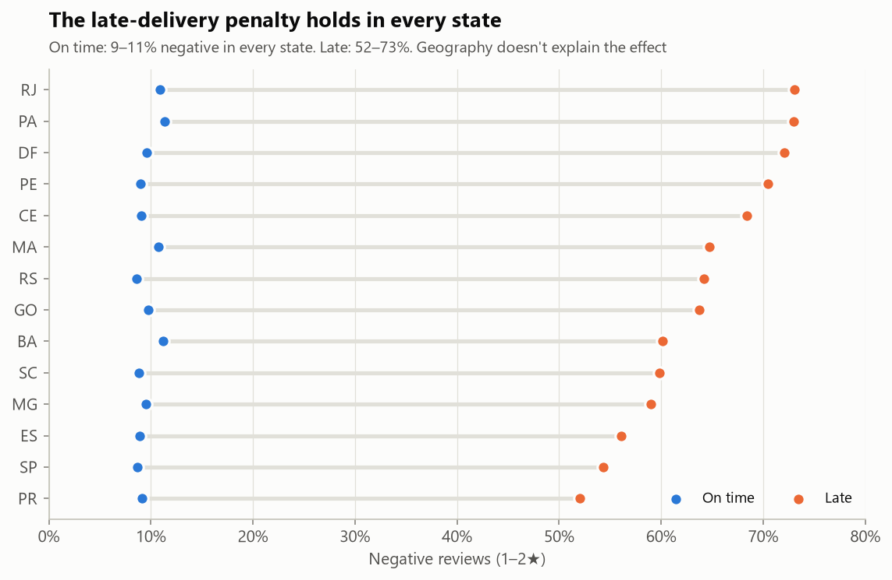
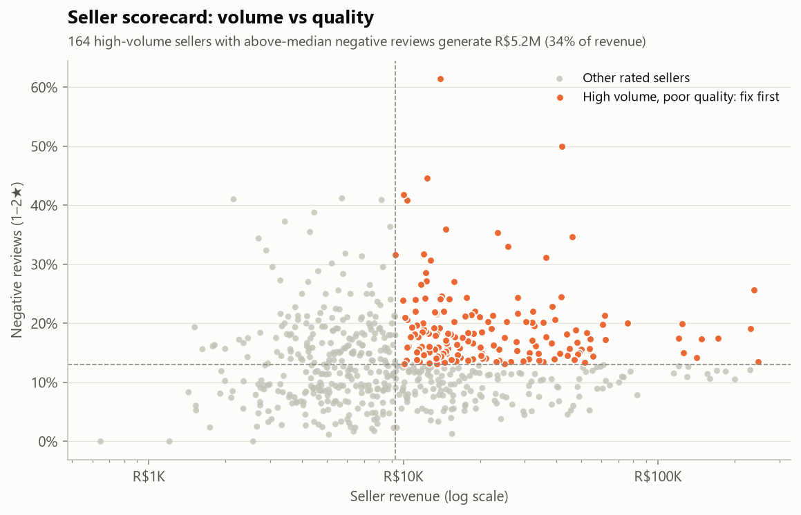
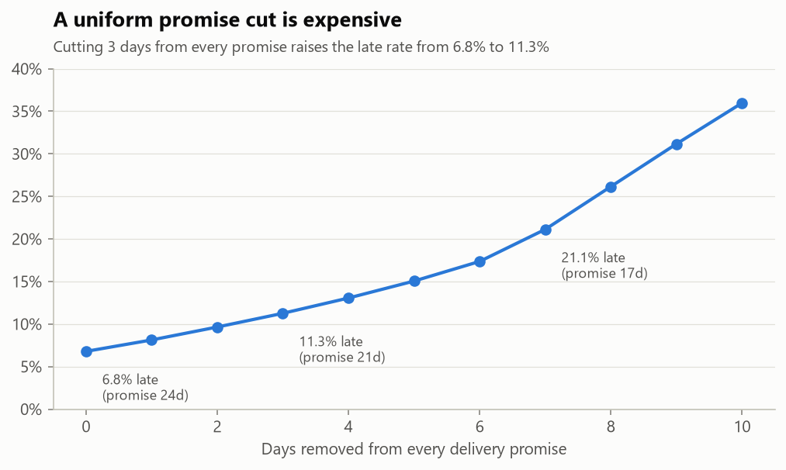
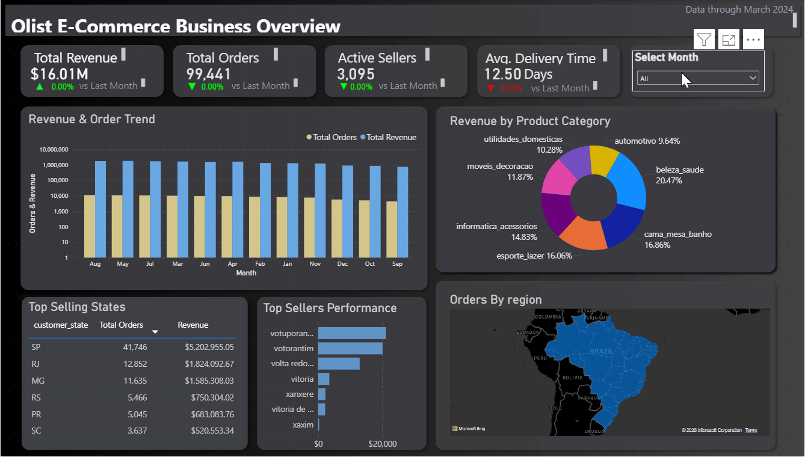

# E-commerce Sales & Customer Insights (Olist, Brazil)

[](https://github.com/Md-Faiz-Alam/ecommerce-sales-customer-insights/actions/workflows/ci.yml)


[](LICENSE)

End-to-end analytics on **~100K real orders** from Olist, a Brazilian marketplace (2017–2018):
a reproducible Python + SQL pipeline, a DuckDB warehouse, statistically tested analysis, and three
machine-learning models that turn the findings into decisions.

> **Core finding:** orders that arrive after the promised date average **2.27★**, versus
> **4.29★** for on-time orders, and only **3.1%** of customers ever buy a second time.
> Delivery reliability is the biggest lever for satisfaction and retention.

**Interactive app** (Streamlit): 4 analytics pages plus a delivery-promise simulator, a review-risk checker with
per-order SHAP explanations, and a demand forecast. Run it with `.\tasks.ps1 app` · <!-- LIVE_APP_LINK: replace with
[Open the live app](https://<your-app>.streamlit.app) after deploying (see app/README.md) -->

<p align="center"></p>

## Key findings (R$15.4M revenue, 99K orders, Jan 2017 – Aug 2018)

| # | Finding | Evidence |
|---|---|---|
| 1 | **Even a short delay destroys ratings.** Late orders are **6.7× as likely** to get 1–2★ (62% vs 9%; Mann-Whitney p < 0.001, rank-biserial r = 0.64). The effect holds in every state (state-adjusted relative risk 6.5), so geography doesn't explain it. Lateness causes **~28% of all negative reviews** | [Notebook 04](notebooks/04_delivery_vs_satisfaction.ipynb) |
| 2 | **Retention is close to zero.** Only 3.1% of customers reorder; no monthly cohort ever retains more than 0.8%. 30% of "repeat" orders are same-day split baskets, not loyalty. A late first order cuts the repeat rate by a further 26% (p = 0.002) | [Notebook 03](notebooks/03_customer_retention.ipynb) |
| 3 | **Peak season breaks logistics.** Black Friday (Nov 2017) lifted orders 63% month over month, and the late rate jumped from 4% to **12%**. Feb–Mar 2018 hit **14–19%** late, with ratings falling to 3.75★ | [Notebook 02](notebooks/02_business_overview.ipynb) |
| 4 | **Promises are padded, but a blanket cut backfires.** Olist promises ~24 days for a ~12.5-day delivery, yet early delivery earns no extra rating. Cutting every promise by 3 days would raise the late rate from 6.8% to 11.3%. The fix is **route-level** promises: same-state orders take 7.9 days, cross-state 15.2 | [Notebook 04](notebooks/04_delivery_vs_satisfaction.ipynb) |
| 5 | **Revenue is concentrated, and at risk.** The top 10% of sellers make 66% of revenue. 164 high-volume sellers with above-median negative reviews (19%; nearly double the late rate of top sellers) generate **R$5.2M (34%)** | [Notebook 05](notebooks/05_sellers_and_geography.ipynb) |
| 6 | **The North-East is underserved.** 60% of sellers are in São Paulo; each extra 1,000 km adds ~6 delivery days. AL, MA, SE, CE: 14–21% late, 16–21% of order value spent on freight | [Notebook 05](notebooks/05_sellers_and_geography.ipynb) |
| 7 | **Value sits in lapsing customers.** "At-risk big spenders" (13.7K customers, last seen ~13 months ago) hold 27% of revenue, which makes them the first win-back target | [Notebook 03](notebooks/03_customer_retention.ipynb) |

All metric definitions: [`docs/metrics.md`](docs/metrics.md).

### Recommendations

1. **Set delivery promises per order from a model** ([notebook 06](notebooks/06_delivery_time_model.ipynb)): it halves late deliveries while promising sooner.
2. **Day-0 alert at carrier handoff** ([notebook 07](notebooks/07_review_risk_model.ipynb)): contact the riskiest 10% of orders *before* the day-1–3 rating cliff, and measure it with an A/B hold-out.
3. **Peak-season playbook** for November and Feb–Mar: book carrier capacity from the 28-day forecast ([notebook 08](notebooks/08_demand_forecast.ipynb)).
4. **Seller SLAs** for the 164 high-volume, low-quality sellers (34% of revenue).
5. **Win-back campaign** for at-risk big spenders, plus a "second order within 30 days" onboarding flow (the median gap to a second order is 28 days).
6. **North-East seller recruitment / fulfilment hub** to cut distance, freight and lateness together.

---

## Machine learning: from insight to decision

Each model answers a decision raised by the analysis. All use a **time-based split** (train Jan 2017 – Apr 2018,
validate May 2018, test Jun – Aug 2018) and **leakage-safe features**: a seller's or route's track record only counts
outcomes known *before* the order was placed, enforced by [unit tests](tests/test_features.py). Full results:
[`reports/model_report.md`](reports/model_report.md).

| Model | Decision | Result on unseen months |
|---|---|---|
| **Delivery-time quantile model** (LightGBM, 10 quantiles) · [notebook 06](notebooks/06_delivery_time_model.ipynb) | What delivery date to promise at checkout | Late deliveries **3.6% → 1.7%** with promises **1.1 days shorter**. Alternative policy: same late rate as today with promises **5 days shorter**. Median error 3.4 days vs 4.7 for the best baseline |
| **Negative-review risk** (LightGBM + SHAP, scored at carrier handoff) · [notebook 07](notebooks/07_review_risk_model.ipynb) | Which orders get proactive care | Contacting the riskiest 10% reaches **28% of future 1–2★ reviews** (2.8× random). PR-AUC 0.24 vs 0.21 (logistic baseline) and 0.18 (purchase-time model) |
| **Daily demand forecast** (ETS + 4-week-mean ensemble, rolling backtest) · [notebook 08](notebooks/08_demand_forecast.ipynb) | How much carrier capacity to book | Daily error **−13%** vs naive; worst 28-day volume miss **18% vs 41%** for the naive model (the May 2018 truckers' strike) |

<p align="center">
  
  
</p>

**Things I checked so the numbers are trustworthy:** test-period drift (Olist got faster in 2018, so test MAE is
reported, not hidden); a dataset extraction cut-off after 21 Aug 2018 (excluded from the forecast); SHAP explanations
that match the analysis (slow routes, multi-item orders, late seller dispatch); and fully reproducible training
(fixed seeds plus a stable row order, so two runs give identical metrics).

---

## Analysis notebooks

Each follows **Question → Method → Finding → Recommendation**, with statistical tests where a claim needs one.

| Notebook | Question | Methods |
|---|---|---|
| [01 Data quality](notebooks/01_data_quality.ipynb) | Can the raw data be trusted? | Missingness patterns, audit trail, contract validation |
| [02 Business overview](notebooks/02_business_overview.ipynb) | Growth, seasonality, revenue mix | MoM/YoY, moving averages, Pareto |
| [03 Customer retention](notebooks/03_customer_retention.ipynb) | Do customers come back? Who should we target? | Cohort analysis, chi-square, RFM segmentation |
| [04 Delivery → satisfaction](notebooks/04_delivery_vs_satisfaction.ipynb) | How much does lateness hurt, and what should we do? | Dose-response, Mann-Whitney U, relative risk + 95% CI, Mantel-Haenszel adjustment, what-if simulation |
| [05 Sellers & geography](notebooks/05_sellers_and_geography.ipynb) | Which sellers and regions need action? | Concentration curve, volume × quality quadrant, distance analysis |
| [06 Delivery-time model](notebooks/06_delivery_time_model.ipynb) | What should we promise each order? | Quantile regression, policy trade-off curve, drift check |
| [07 Review-risk model](notebooks/07_review_risk_model.ipynb) | Which orders need proactive care? | Gradient boosting vs baselines, PR curve, cumulative gains, SHAP |
| [08 Demand forecast](notebooks/08_demand_forecast.ipynb) | How much capacity to book? | ETS, naive baselines, ensemble, rolling-origin backtest |

<p align="center">
  
  
  
  
</p>

---

## Quickstart (Windows / PowerShell, Python 3.13)

```powershell
.\tasks.ps1 setup      # create .venv, install pinned dependencies
.\tasks.ps1 data       # download raw Olist CSVs from Kaggle into data/raw/
.\tasks.ps1 pipeline   # clean -> validate -> Parquet -> DuckDB warehouse -> quality report
.\tasks.ps1 train      # train the 3 ML models -> reports/model_report.md (~20 s)
.\tasks.ps1 export     # star-schema CSVs for Power BI -> data/powerbi/
.\tasks.ps1 app        # run the Streamlit app (http://localhost:8501)
.\tasks.ps1 notebooks  # re-run the analysis notebooks (refreshes reports/figures)
.\tasks.ps1 test       # unit tests
```

The pipeline rebuilds everything from raw data in about 10 seconds:

- `data/processed/*.parquet`: cleaned tables
- `data/warehouse.duckdb`: queryable warehouse (`staging` schema)
- [`reports/data_quality_report.md`](reports/data_quality_report.md): every cleaning rule and the number of rows it affected, plus all validation results

---

## Pipeline

```
data/raw/*.csv ─► clean.py ─► validate.py ─► DuckDB staging ─► marts (star schema) ─► analysis views
   (Kaggle)       documented   pandera +        Parquet          sql/01_marts          sql/02_analysis
                  rules, flags foreign keys                          └──── sql/tests: 8 data tests ────┘
```

The SQL layer is documented in [`sql/README.md`](sql/README.md): a star schema plus 8 analysis views
using window functions (`LAG`, `NTILE`, `DENSE_RANK`, running totals), cohort indexing, and RFM/ABC
classification. The pipeline fails if any SQL data test (row counts, revenue reconciliation,
uniqueness) breaks.

### Data-cleaning decisions

| Problem found | Decision |
|---|---|
| `customer_id` is generated per order | Customer counts and retention use `customer_unique_id` (**96,096** people, not 99,441) |
| 4 products with weight/dimension = 0, 2 missing | Treated as missing (NA) and flagged; never filled with fake zeros |
| 610 products without a category; names in Portuguese | `unknown`; translated to English, including 2 categories missing from Olist's own translation file |
| 551 orders with several reviews | Keep the latest review per order (order-level grain) |
| Sparse months (Sep–Dec 2016, Sep–Oct 2018) | Kept but flagged `in_analysis_window = false`, and excluded from trends and forecasts |
| 1,359 orders handed to the carrier before payment approval; 8 "delivered" orders with no date | Flagged in `has_timestamp_anomaly`, not silently fixed |
| "Late" definition | Delivered on a calendar day after the promised date (**6.8%** of delivered orders) |
| 1M geolocation points, some outside Brazil | Out-of-country GPS noise removed; collapsed to one median centroid per zip prefix |
| Revenue definition | Completed revenue counts only orders with `is_delivered = true` (delivered status plus a delivery date) |

The full audit trail is in [`reports/data_quality_report.md`](reports/data_quality_report.md).

---

## Dashboard (Power BI)

Four pages on a star schema exported from the warehouse (`.\tasks.ps1 export`): **Executive Overview**,
**Delivery & Satisfaction**, **Customers & Retention** (cohort heatmap, RFM) and **Seller Performance**
(volume × quality scatter, drill-through), plus an optional ML planning page.

- Marked date table, so MoM/YoY time intelligence is correct and months sort chronologically
- Revenue measured from the item fact, so category and seller slicers filter it correctly
- Advanced DAX: `TOPN` + `ADDCOLUMNS` seller concentration, dynamic MoM labels, data-driven date labels
- Every KPI reconciles to the SQL warehouse (checklist in the guide)

Build spec, DAX and theme: [`dashboard/POWERBI_GUIDE.md`](dashboard/POWERBI_GUIDE.md) ·
[`measures.dax`](dashboard/measures.dax) · [`olist_theme.json`](dashboard/olist_theme.json)

<!-- After rebuilding, add the new screenshots:
<p align="center"></p>
<p align="center">
  
  
</p>
-->

The `.pbix` file is attached to the GitHub release.

---

## Engineering & testing

Every push runs [GitHub Actions CI](.github/workflows/ci.yml): pre-commit lint (ruff, notebook hygiene) and
**47 tests on Python 3.12 and 3.13**. CI has no access to the 180 MB raw data, so the suite is designed to work without it:

| Test file | What it proves |
|---|---|
| `test_pipeline_e2e.py` | A synthetic Olist-shaped dataset goes through the **whole pipeline**: cleaning, data contracts, DuckDB marts, all analysis views and all 8 SQL data tests, then feature building and training both ML models |
| `test_clean.py`, `test_validate.py` | Each cleaning rule (calendar-day lateness, no fake zeros, latest review per order) and that the contracts catch bad data |
| `test_features.py` | **No leakage**: an order never sees its own or future outcomes; rolling windows drop old events |
| `test_models.py` | Promise/late accounting, top-k lift, and a backtest that never trains on the future |
| `test_app_parity.py` | The app's exported text models reproduce the training predictions exactly (no training/serving skew) |
| `test_app_smoke.py` | Every Streamlit page renders; overview KPIs match the warehouse; the risk checker flags a risky order |

Core modules (cleaning, contracts, warehouse, features, models) have **96–100% line coverage**, 69% overall.
The uncovered code is CLI orchestration that runs against the real data, and chart styling.

## Project structure

```
├── src/ecom/            # package: pipeline (clean, validate, warehouse), features, chart style
│   └── models/          # delivery_time, review_risk, forecast, train
├── notebooks/           # 01–05 analysis, 06–08 machine learning
├── app/                 # Streamlit app (self-contained: data + text models, ~6 MB)
├── scripts/             # download_data.py
├── sql/                 # DuckDB: 01_marts (star schema), 02_analysis (views), tests
├── docs/                # metric definitions
├── tests/               # 47 tests: e2e pipeline on synthetic data, leakage, parity, app smoke
├── .github/workflows/   # CI: lint + tests on Python 3.12 / 3.13
├── reports/             # generated data-quality report, figures/
├── dashboard/           # Power BI guide, DAX measures, theme (.pbix in the release)
├── images/              # dashboard screenshots
├── data/                # raw + processed (git-ignored; rebuilt by the pipeline)
├── tasks.ps1            # task runner
└── pyproject.toml       # package + tooling config
```

## Roadmap

- [x] Reproducible pipeline, data contracts, data-quality report, tests
- [x] SQL marts (star schema) + cohort retention, RFM, Pareto, seller scorecard, SQL data tests
- [x] Analysis notebooks: delivery → satisfaction (with statistical tests), retention, seller and geography
- [x] ML: delivery-time quantile model, negative-review risk model (LightGBM + SHAP), demand forecast
- [x] Streamlit app with ML simulators + serving-parity tests
- [ ] Deploy the app to Streamlit Community Cloud and link it here
- [x] Power BI: star-schema export, DAX measures, theme, build guide
- [x] CI: lint + 47 tests (e2e on synthetic data, leakage, parity, app smoke) on Python 3.12/3.13
- [ ] Power BI: rebuild the .pbix from the guide + new screenshots
- [ ] Executive summary

## Tech stack

Python 3.13 · pandas 3 · DuckDB (SQL) · SciPy · scikit-learn · LightGBM · SHAP · statsmodels · Streamlit · Plotly · matplotlib · pandera · pytest · ruff · Power BI

## Limitations

- Olist's delivery speed improved during 2018, so models trained on 2017 data are conservative on 2018 orders (reported in notebook 06).
- Orders after 21 Aug 2018 are truncated by the dataset extraction, so August 2018 KPIs are slightly understated.
- Review scores depend on product quality and expectations, which this data doesn't capture.
- Causal claims (e.g. "lateness causes bad reviews") are supported by dose-response and state-adjusted analysis,
  but the recommended interventions should still be validated with A/B tests.

## Data

[Olist Brazilian E-Commerce Public Dataset](https://www.kaggle.com/datasets/olistbr/brazilian-ecommerce) (CC BY-NC-SA 4.0). Values are in Brazilian reais (BRL).
